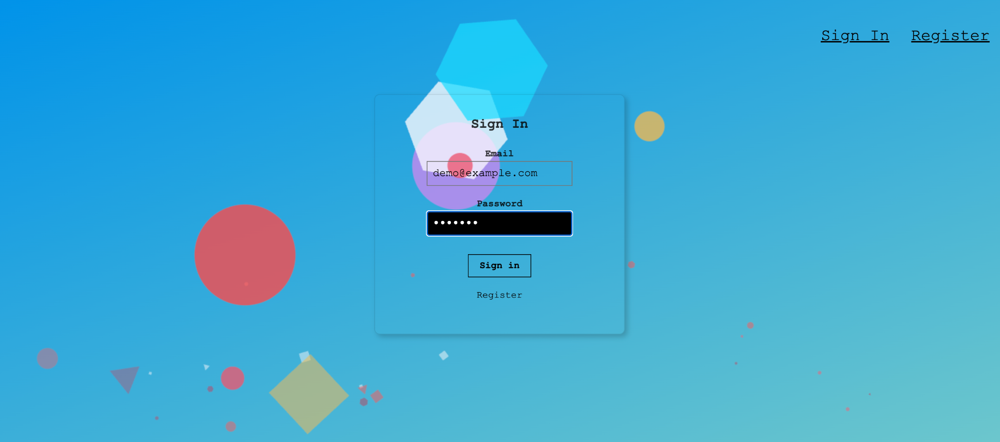
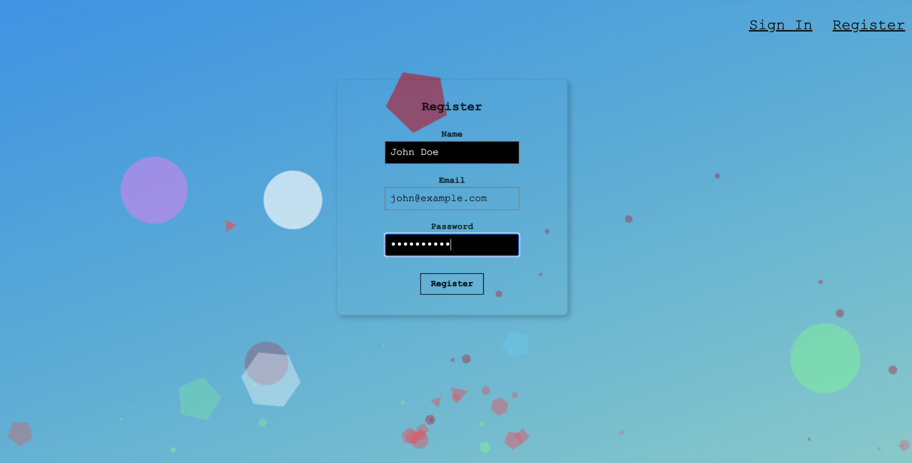
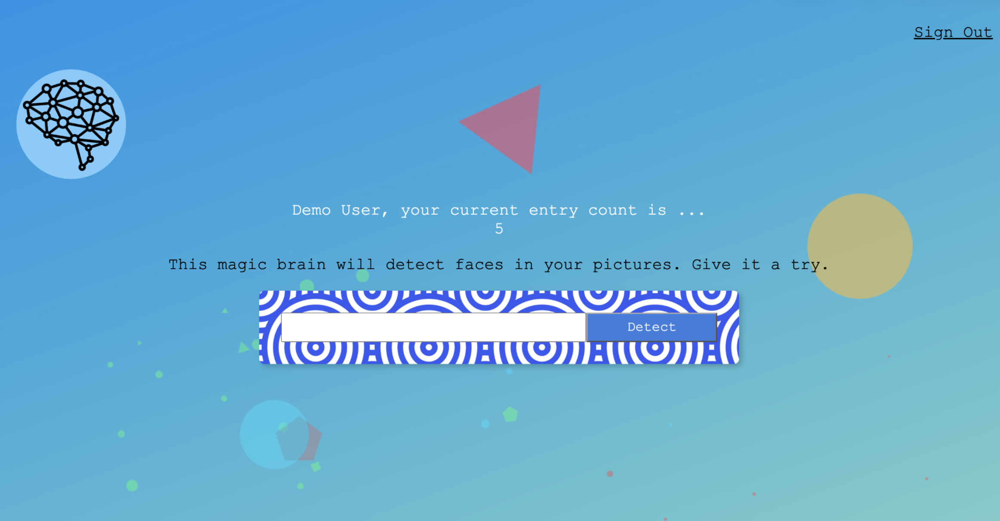

# Smart Brain

> [!WARNING]
> **Clarifai API Discontinued:** The Clarifai platform was sunset on July 17, 2026. Face recognition functionality is no longer operational. The application remains available to demonstrate its original architecture, authentication, database integration, and API implementation.

Smart Brain is a full-stack face recognition application developed as part of my learning experience at **Zero to Mastery Academy (ZTM)**.

The application allows users to register, sign in, and submit image URLs for face recognition through the Clarifai API.

## Screenshots

### Sign In


### Registration


### Main Application


## Demo Access

No registration required.

| Credential | Value |
|---|---|
| Email | `demo@example.com` |
| Password | `Demo123` |

The demo account uses a static user profile and does not require database authentication.

## Features

- User registration and authentication
- Password hashing with bcrypt
- PostgreSQL database integration
- React-based frontend
- REST API built with Node.js and Express
- Original Clarifai API integration for face recognition (discontinued)

## Technologies

- **Frontend:** React, JavaScript, CSS, Tachyons
- **Backend:** Node.js, Express.js
- **Database:** PostgreSQL, Knex.js
- **Authentication:** bcrypt-nodejs
- **External API:** Clarifai

## Getting Started

### Prerequisites

- Node.js and npm
- PostgreSQL (for database-backed registration and authentication)

### 1. Clone the Repository

```bash
git clone YOUR_REPOSITORY_URL
cd smart-brain
```

### 2. Install Backend Dependencies

```bash
cd backend
npm install
```

### 3. Install Frontend Dependencies

Open a second terminal:

```bash
cd frontend
npm install
```

### 4. Configure Environment Variables

Configure the backend environment variables for your PostgreSQL connection.

```env
DATABASE_URL=your_postgresql_connection_string
DATABASE_HOST=localhost
DATABASE_USER=your_database_user
DATABASE_PW=your_database_password
DATABASE_DB=smart_brain
```

Create the database and configure the connection before using database-backed registration and authentication.

Do not commit your `.env` file or database credentials.

### 5. Start the Backend

From the `backend` directory:

```bash
npm start
```

The backend runs on `http://localhost:3001`.

For development with automatic restarts:

```bash
npm run start:dev
```

### 6. Start the Frontend

From the `frontend` directory:

```bash
npm start
```

The React application runs at `http://localhost:3000`.

### 7. Sign In

Use the demo credentials:

- **Email:** `demo@example.com`
- **Password:** `Demo123`

## What I Learned

This project helped me understand how different technologies work together to build a full-stack web application.

- **Authentication:** Implementing user registration and login, including password hashing with bcrypt.
- **APIs:** Understanding what APIs are and how to integrate external services into a web application.
- **Database Management:** Using PostgreSQL to store and retrieve user information.
- **Backend Development:** Building server-side functionality and REST endpoints with Express.js.
- **Frontend and Backend Integration:** Connecting a React frontend to an Express backend through HTTP requests.

## Project Background

This project was completed as part of the Zero to Mastery Academy web development curriculum. It provided practical experience connecting frontend and backend technologies, implementing authentication, working with databases, and integrating external APIs.
